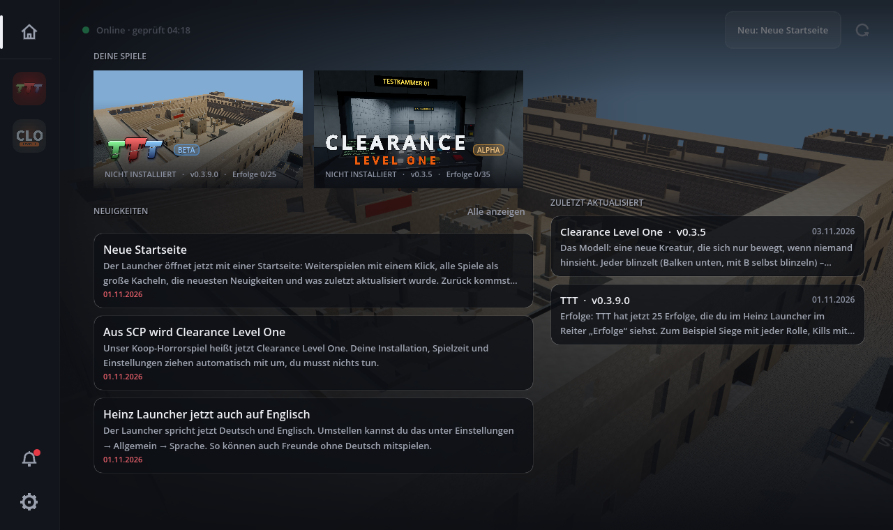
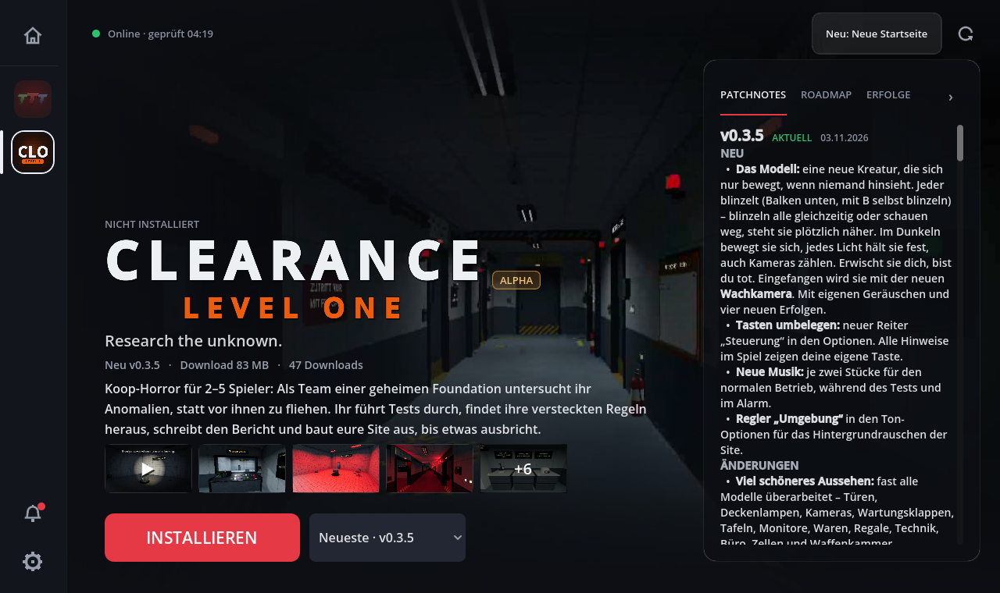
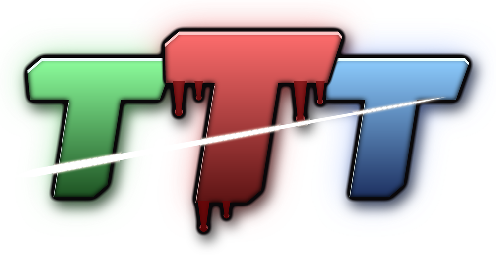
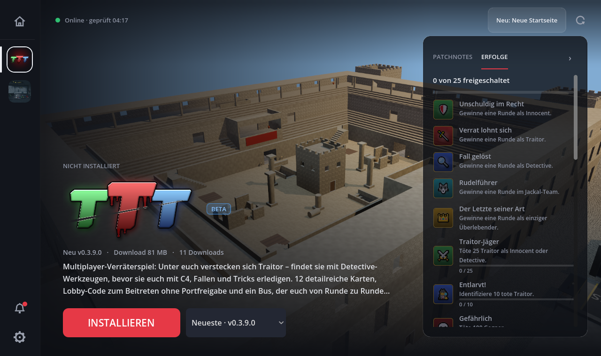
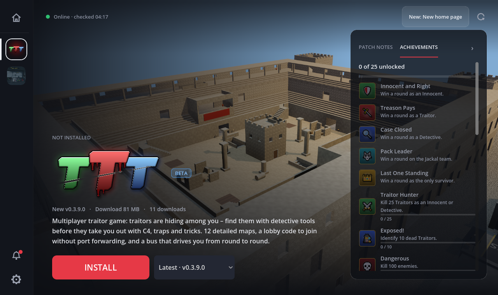

<h1 align="center">Heinz Launcher</h1>

  Ein Launcher für die Spiele von HeinzAnimation6 – installieren, aktualisieren und starten mit einem Klick. 
  <i>A launcher for HeinzAnimation6's games – install, update and play with one click.</i>

  <a href="https://github.com/HeinzAnimation6/game-releases/releases/download/launcher/Heinz-Launcher-Setup.exe"><b>⬇ Heinz-Launcher-Setup.exe herunterladen / download</b></a>
   Windows 10 / 11 · 64 Bit · kostenlos / free

<a href="#deutsch">Deutsch</a> · <a href="#english">English</a>

---

## Deutsch

### Installieren

1. **[Heinz-Launcher-Setup.exe herunterladen](https://github.com/HeinzAnimation6/game-releases/releases/download/launcher/Heinz-Launcher-Setup.exe)**
2. Die Datei starten. Der Installer lädt dabei automatisch die neueste Launcher-Version.
3. Den **Heinz Launcher** über das Symbol auf dem Desktop oder im Startmenü öffnen.
4. Links ein Spiel wählen und auf **Installieren** klicken. Fertig.

Administratorrechte und ein GitHub-Konto sind nicht nötig.

> **Windows sagt „Der Computer wurde durch Windows geschützt“?**
> Das kommt bei kleinen Programmen ohne gekauftes Zertifikat vor. Auf **Weitere Informationen** und dann auf **Trotzdem ausführen** klicken.

### Spiele

**Clearance Level One** · *Alpha* · Koop-Horror für 2–5 Spieler

Als Team einer geheimen Foundation untersucht ihr Anomalien, statt vor ihnen zu fliehen. Ihr führt Tests durch, findet ihre versteckten Regeln heraus, schreibt den Bericht und baut eure Site aus – bis etwas ausbricht.

**TTT** · *Beta* · Multiplayer-Verräterspiel

Unter euch verstecken sich Traitor – findet sie mit Detective-Werkzeugen, bevor sie euch mit C4, Fallen und Tricks erledigen. 12 detailreiche Karten, Lobby-Code zum Beitreten ohne Portfreigabe und ein Bus, der euch von Runde zu Runde fährt.

### Was der Launcher kann

- **Automatische Updates** für Spiele und Launcher. Meist wird nur der geänderte Teil geladen statt des ganzen Spiels.
- **Patchnotes, Roadmap und Erfolge** für jedes Spiel, mit Datum.
- **Ältere Versionen** spielen, inklusive der allerersten – so sieht man, wie das Spiel am Anfang aussah.
- **Trailer, Bilder und Neuigkeiten** direkt im Launcher.
- **Spielzeit**, Download-Limit, Startparameter und ein frei wählbarer Spiele-Ordner.
- **Deutsch und Englisch.** Umstellen unter Einstellungen → Allgemein → Sprache.

### Updates

Du musst nichts tun. Der Launcher sucht beim Start und regelmäßig nach neuen Versionen und lädt sie selbst. Ein Launcher-Update ist nach dem nächsten Neustart aktiv. Laufende Spiele werden dabei nicht unterbrochen.

### Deinstallieren

Über Windows: **Einstellungen → Apps → Heinz Launcher → Deinstallieren**. Danach fragt der Uninstaller, ob auch die installierten Spiele und die Launcher-Einstellungen (`%APPDATA%\HeinzLauncher`) gelöscht werden sollen.

---

## English

### Install

1. **[Download Heinz-Launcher-Setup.exe](https://github.com/HeinzAnimation6/game-releases/releases/download/launcher/Heinz-Launcher-Setup.exe)**
2. Run it. The installer automatically fetches the newest launcher version.
3. Open the **Heinz Launcher** from your desktop or start menu.
4. Pick a game on the left and click **Install**. Done.

No admin rights and no GitHub account needed.

> **Windows says "Windows protected your PC"?**
> That happens with small programs without a paid certificate. Click **More info**, then **Run anyway**.

### Games

**Clearance Level One** · *Alpha* · co-op horror for 2–5 players

As a team of a secret Foundation you study anomalies instead of running from them. Run tests, find out their hidden rules, write the report and expand your site – until something breaks out.

**TTT** · *Beta* · multiplayer traitor game

Traitors are hiding among you – find them with detective tools before they take you out with C4, traps and tricks. 12 detailed maps, a lobby code to join without port forwarding, and a bus that drives you from round to round.

### Features

- **Automatic updates** for games and the launcher. Usually only the changed part is downloaded, not the whole game.
- **Patch notes, roadmap and achievements** for every game, with dates.
- **Play older versions**, including the very first one – see what the game looked like at the start.
- **Trailers, pictures and news** right in the launcher.
- **Play time**, download limit, launch options and a games folder of your choice.
- **English and German.** Change it under Settings → General → Language.

### Updates

Nothing to do. The launcher checks for new versions on start and regularly while open, and downloads them itself. A launcher update is active after the next restart. Running games are never interrupted.

### Uninstall

Through Windows: **Settings → Apps → Heinz Launcher → Uninstall**. The uninstaller then asks whether the installed games and launcher settings (`%APPDATA%\HeinzLauncher`) should be deleted too.

---

Dieses Repository enthält die Download-Dateien für den Launcher (Release <a href="https://github.com/HeinzAnimation6/game-releases/releases/tag/launcher">launcher</a>). Sie werden automatisch aktualisiert. 
This repository holds the launcher's download files (release <a href="https://github.com/HeinzAnimation6/game-releases/releases/tag/launcher">launcher</a>). They are updated automatically.
