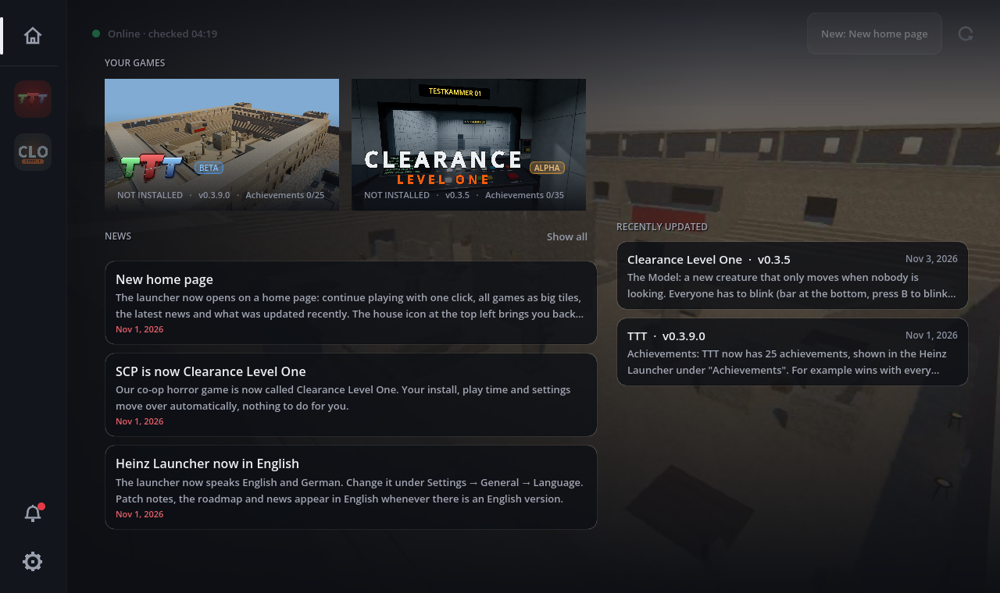
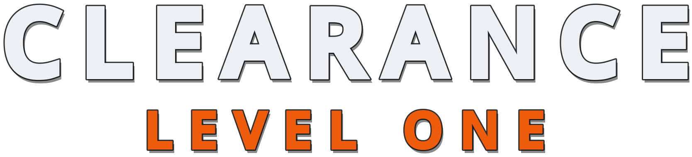
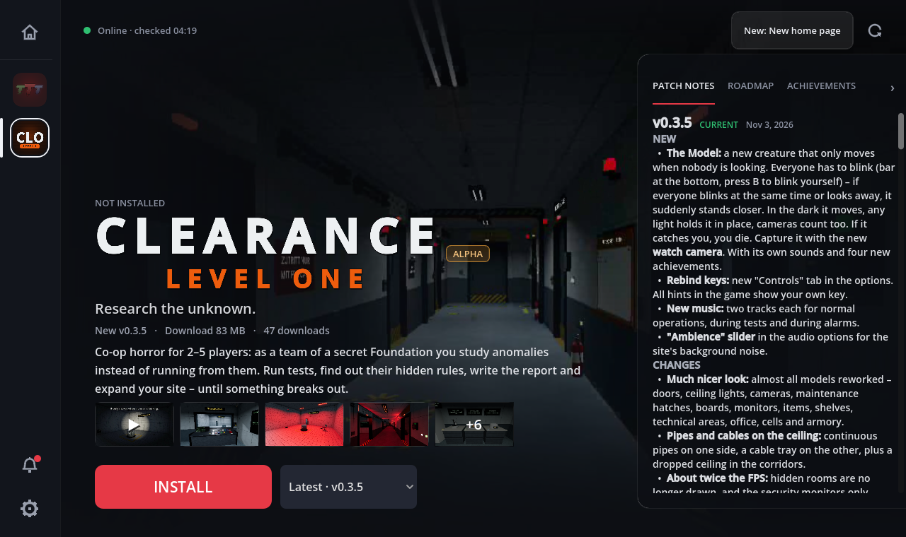
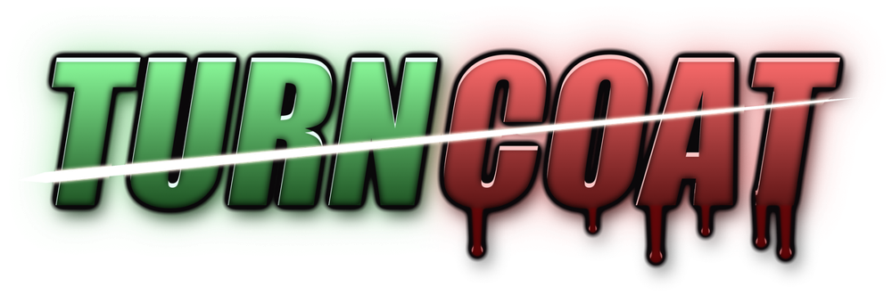
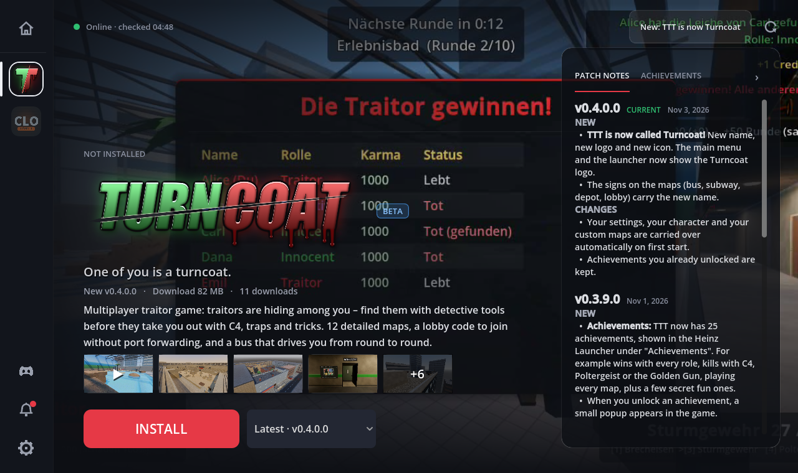

<h1 align="center">Heinz Launcher</h1>

  A launcher for HeinzAnimation6's games – install, update and play with one click.

  <a href="https://github.com/HeinzAnimation6/game-releases/releases/download/launcher/Heinz-Launcher-Setup.exe"><b>⬇ Download Heinz-Launcher-Setup.exe</b></a>
  &nbsp;·&nbsp;
  <a href="https://discord.gg/RmmRP88ZGW"><b>💬 Join the Discord</b></a>
   Windows 10 / 11 · 64-bit · free

## Install

1. **[Download Heinz-Launcher-Setup.exe](https://github.com/HeinzAnimation6/game-releases/releases/download/launcher/Heinz-Launcher-Setup.exe)**
2. Run it. The installer automatically fetches the newest launcher version.
3. Open the **Heinz Launcher** from your desktop or start menu.
4. Pick a game on the left and click **Install**. Done.

No admin rights and no GitHub account needed.

> **Windows says "Windows protected your PC"?**
> That happens with small programs without a paid certificate. Click **More info**, then **Run anyway**.

## Games

**Clearance Level One** · *Alpha* · co-op horror for 1–5 players

As a team of a secret Foundation you study anomalies instead of running from them. Run tests, find out their hidden rules, write the report and expand your site – until something breaks out.

**Turncoat** · *Beta* · multiplayer traitor game (formerly TTT)

*One of you is a turncoat.* Traitors are hiding among you – find them with detective tools before they take you out with C4, traps and tricks. 12 detailed maps, a lobby code to join without port forwarding, and a bus that drives you from round to round.

## Features

- **Automatic updates** for games and the launcher. Usually only the changed part is downloaded, not the whole game.
- **Patch notes, roadmap and achievements** for every game, with dates.
- **Play older versions**, including the very first one – see what the game looked like at the start.
- **Trailers, pictures and news** right in the launcher.
- **Play time**, download limit, launch options and a games folder of your choice.
- **English and German.** Change it under Settings → General → Language.

## Updates

Nothing to do. The launcher checks for new versions on start and regularly while open, and downloads them itself. A launcher update is active after the next restart. Running games are never interrupted.

## Community

Questions, bugs or ideas? Come say hi on the **[Discord server](https://discord.gg/RmmRP88ZGW)** – there's also a Discord button at the bottom left of the launcher.

## Uninstall

Through Windows: **Settings → Apps → Heinz Launcher → Uninstall**. The uninstaller then asks whether the installed games and launcher settings (`%APPDATA%\HeinzLauncher`) should be deleted too.

---

This repository holds the launcher's download files (release <a href="https://github.com/HeinzAnimation6/game-releases/releases/tag/launcher">launcher</a>). They are updated automatically.
